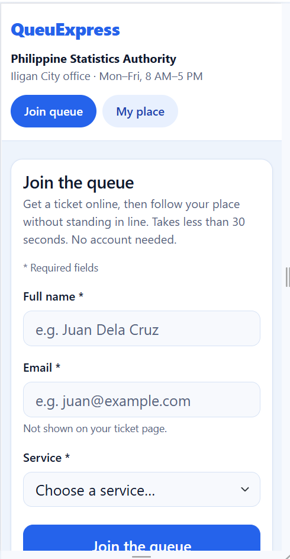
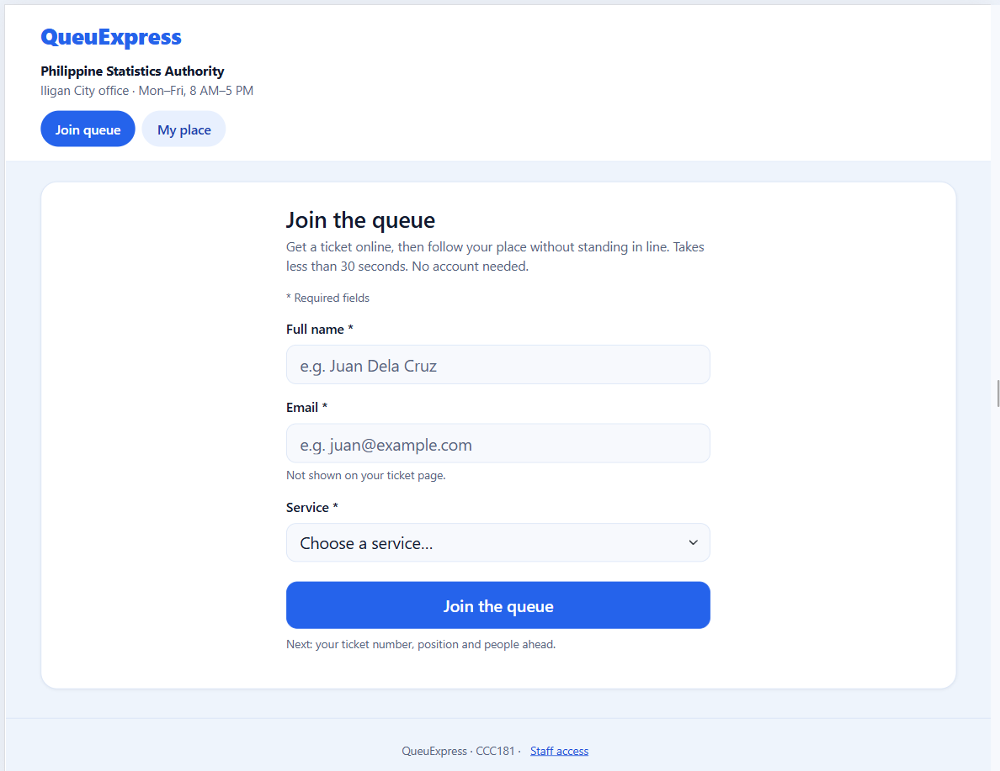
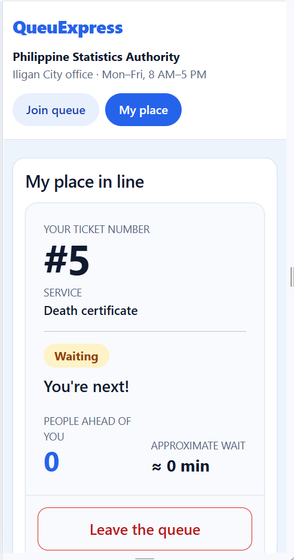
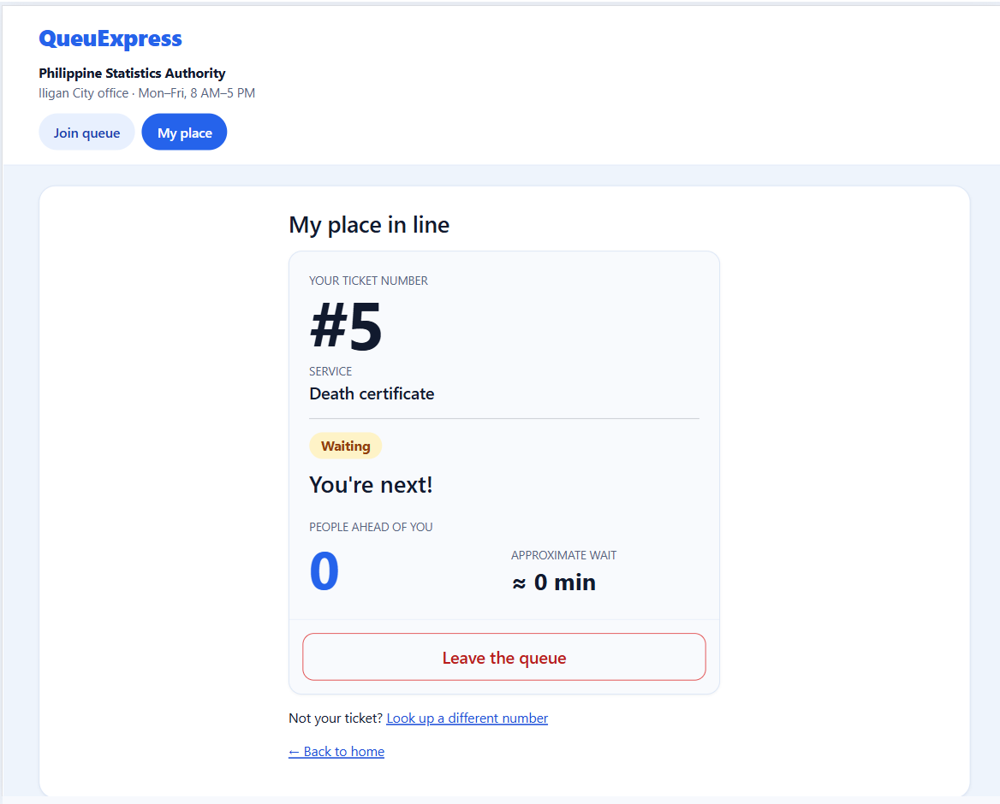
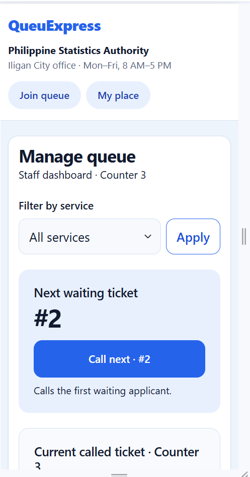
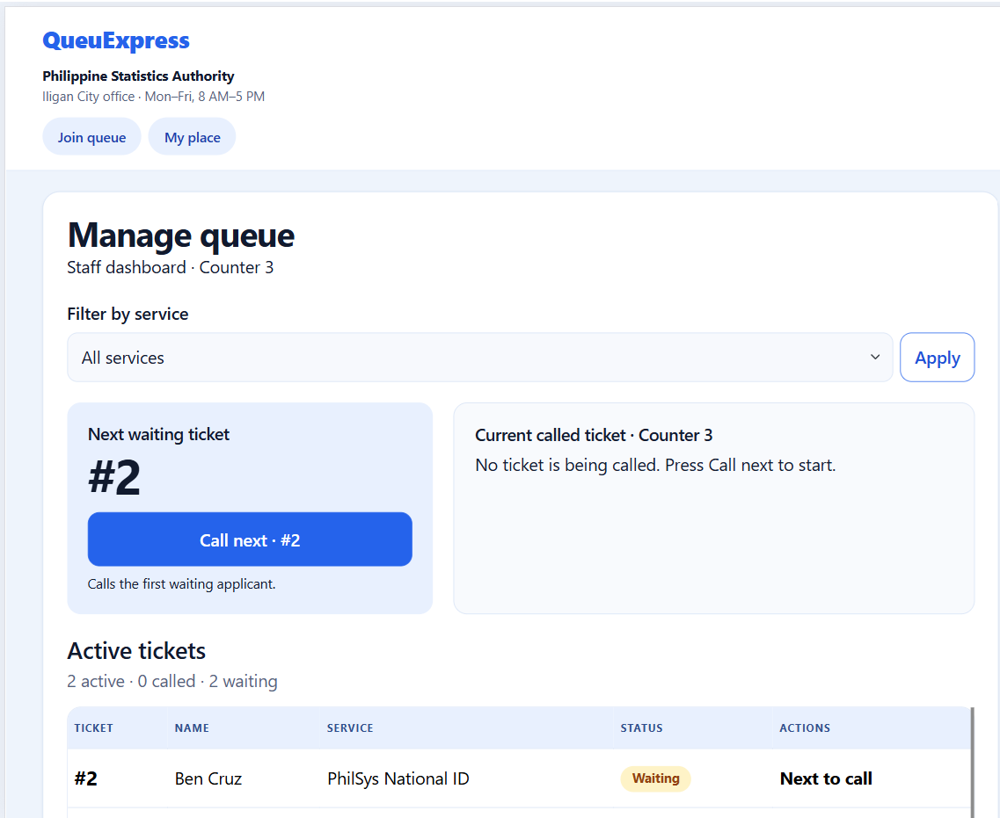

# QueuExpress: Week 3 Report

## 1. Title details

- **App:** QueuExpress, a queue tracker
- **Setting:** Philippine Statistics Authority, Iligan City office
- **Name:** Julius G. Zalsos
- **Student ID:** [ID]
- **Section:** [section]
- **Date:** [date submitted]
- **Pull request:** [link to your PR]

## 2. Personas

Full personas: [docs/week3/personas.md](personas.md)

**James Marthurin, applicant (35).** *"Time is money, but if I'm stuck waiting for 6 hours to get service, then I may as well beg."* Top tasks: join the queue (FR-01), check his place (FR-02), leave the queue (FR-03).

**Donna Magsukul, counter officer (50).** *"I spend half my day squinting at small screen text and answering the same 'Is it my turn?' questions instead of actually serving people."* Top tasks: filter by service (FR-04), call the next applicant (FR-05), serve or no-show (FR-06).

## 3. Screens

**Join the queue.** James joins on his phone and covers FR-01, NFR-01 and NFR-02.

**My place.** James checks his number, status, people ahead and wait, and can leave; covers FR-02, FR-03, NFR-03 and NFR-04.

**Manage queue.** Donna filters, calls and serves tickets; covers FR-04, FR-05, FR-06 and NFR-01.

## 4. Design decisions

1. **Big ticket number and people ahead on My place.** James told me he cannot spend rest time on a day off guessing, so his number and people ahead are the largest things on the page (personas.md, James rule 3).
2. **Serve is solid green, No-show is a red outline, Call next is blue.** My self-review found that Donna could not tell "start" from "finish" by color when rushing. The shape and text differ too, so color is not the only cue (Donna rule 2).
3. **Status shown in words and a text headline.** The lobby is noisy, so nothing relies on sound or color; badges say Waiting or Called and My place adds "You're next!" (James rule 2, NFR-02).

## 5. Self-review

Full review: [feedback.md](feedback.md). Main problems and changes:
- **Join:** the applicant nav showed staff links, so staff access moved to a separate footer link.
- **My place:** position and people ahead were two competing numbers, so "people ahead" became the main figure.
- **Manage queue:** Call next and Serve were both blue, so Serve is now green and No-show a red outline.

## 6. Accessibility

Lighthouse Accessibility (mobile): Join **100**, My place **100**, Staff **100**. Full notes: [accessibility.md](accessibility.md).

Most important issue fixed: [one real issue, e.g. the broken staff table on phones, where the header hid the Name column but the rows did not, replaced with stacked cards at phone width].

## 7. Usability test

Details: [usability-test.md](usability-test.md).

| Task | Finished? | Time |
|---|---|---|
| Get in line | Yes | [about __ s] |
| Find people ahead and number | Yes | [about __ s] |
| Call next and serve | Yes | [about __ s] |

**Improvement:** "People ahead of you" was small text and is now a large figure beside the wait time.

| Before | After |
|---|---|
|  |  |

## 8. Reflection

**Hardest:** [your own words. For example, keeping the wireframes, the code and the proposal consistent as I changed them.]

**What changes with a database in Week 4:**
- Ticket numbers will come from the database, not `TICKETS[-1]["number"] + 1`, and will need a per-day reset.
- Statuses (`waiting`, `called`, `served`, `no-show`, `cancelled`) will be stored values, with a check so only valid ones are saved.
- The My place lookup should ask for the email used to join as well as the number, so a typo cannot show or cancel someone else's ticket.
- Display tickets as `A-024` from the stored integer, as in my wireframes.

## 9. Declaration

I used Claude (Anthropic's AI assistant) [edit to match what you actually did: drafting code for the Flask routes and templates, the Bootstrap styling, and the first drafts of feedback.md, accessibility.md and this report]. I reviewed and tested the code and wrote the final decisions myself. Other sources: Bootstrap 5.3.3 documentation, Flask documentation.