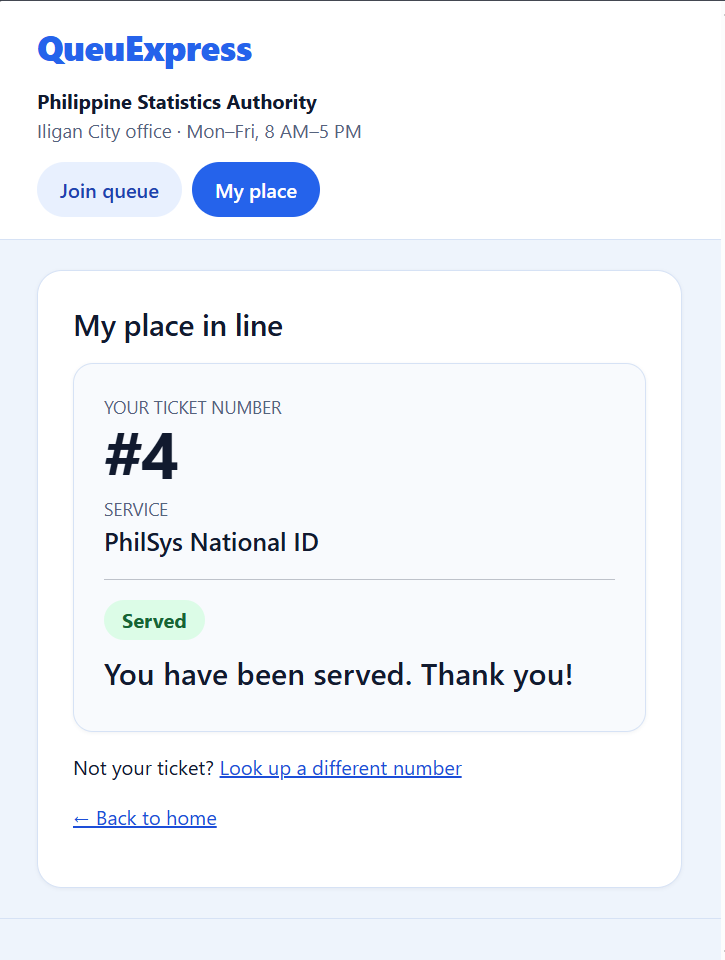
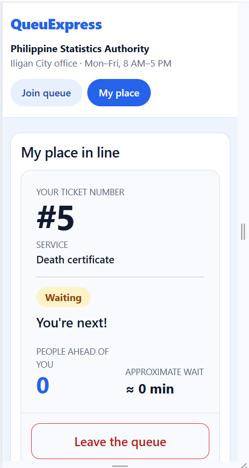

# Week 3: Usability test

## 10a. Test session

- **Tester:** A government employee
- **Persona matched:** Donna (staff), since the tester works in a government office. They also played James (applicant) for tasks 1 and 2.
- **Setting and device:** In person, on laptop
- **Consent:** They consented to the test.

| Task | Finished? | About how long | Where they hesitated / what they said / what surprised me |
|---|---|---|---|
| 1. "You just arrived. Get in line for [service]." | Yes | Less than a minute | No hesitation. |
| 2. "How many people are ahead of you? What is your number?" | Yes | Less than a minute | They said seeing how many people are ahead of their ticket makes it easy to track and expect. |
| 3. "Pretend you are the staff member. Call the next person and mark them as served." | Yes | Less than a minute | They said it was easy to navigate since it is just tapping buttons. |

**Overall:** The tester finished all three tasks without help, in under a minute each. They found the controls and buttons easy to find and use.

### Which "Because ..., my interface must ..." rules held up

- **James rule 1 (large, full-width buttons for one-thumb use):** Held up. The tester found the join and leave controls without hesitation.
- **James rule 3 (people ahead and wait are prominent):** Held up. The tester found the people-ahead count and their number easily and said it helps them track their place.
- **Donna rule 2 (distinct, large action buttons, one click):** Held up. The tester said the staff page is "just tapping buttons" and finished call and serve without help.
- **Did not hold up:** None observed in this test. Donna's rule 1 (large high-contrast text) was not tested directly, since the tester did not comment on text size.

## 10b. One improvement

- **Problem:** On My place, the number of people ahead (the figure James uses to decide whether he can step outside) was only a line of text, smaller than the rest of the page. My self-review flagged this (feedback.md, My place), and James rule 3 says it should be among the most prominent elements.
- **Fix:** "People ahead of you" is now a large figure beside the approximate wait, and the auto-refresh script updates it every 10 seconds.
- **Before:**

  
- **After:**

  